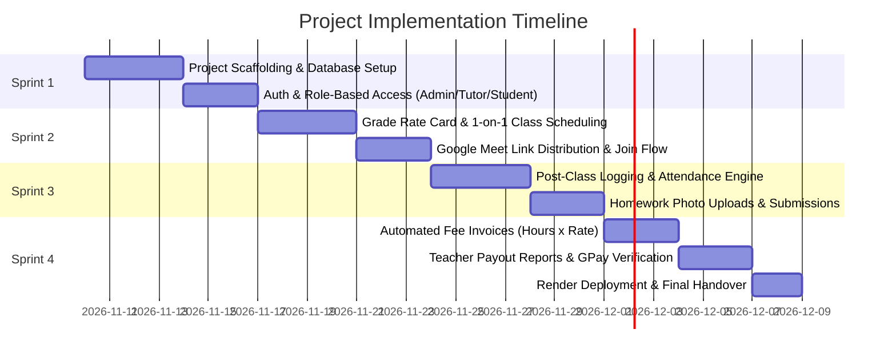

# Project Development Plan & Implementation Roadmap
**Project Name:** 1-on-1 Online Tuition & Billing Management System  
**Architecture:** React (Vite) + Node.js (Express) + PostgreSQL  
**Deployment Platform:** Render  
**Target Completion:** 3–4 Weeks  
**Version:** 1.0  

---

## 1. Technical Architecture Overview

To ensure high performance, easy maintenance, and zero hosting complications, the application follows a modern decoupled architecture:

```
┌──────────────────────────────────────────────────────────────┐
│                      RENDER CLOUD HOSTING                    │
│                                                              │
│  ┌─────────────────────────┐      ┌────────────────────────┐ │
│  │   Frontend (Static)     │      │   Backend (Web Svc)    │ │
│  │   React (Vite)          │◄────►│   Node.js + Express    │ │
│  │   Tailwind CSS          │ HTTP │   JWT Auth & APIs      │ │
│  └─────────────────────────┘      └───────────┬────────────┘ │
│                                               │ Prisma ORM   │
│                                   ┌───────────▼────────────┐ │
│                                   │   Managed PostgreSQL   │ │
│                                   │   Database Instance    │ │
│                                   └────────────────────────┘ │
└──────────────────────────────────────────────────────────────┘
```

### Technology Selections:
* **Frontend (`/client`):** **React with Vite** for lightning-fast page loading and responsive design using **Tailwind CSS**. Fully optimized for mobile phones and laptops.
* **Backend (`/server`):** **Node.js with Express.js** providing secure, robust RESTful APIs.
* **Database:** **PostgreSQL** with **Prisma ORM** to ensure strict financial data integrity (guaranteeing that every class attended matches the student's bill).
* **Storage:** Local / Cloud storage for homework photo uploads.
* **Hosting:** **Render** (Free tier hosting for static site, web service, and PostgreSQL database).

---

## 2. Sprint & Milestone Breakdown

The development is divided into **4 vertical milestones**. At the end of each milestone, a working demonstration will be shown.



---

### Sprint 1: Foundation, Database & Authentication
* **Deliverables:**
  1. Monorepo folder setup (`client/` and `server/`).
  2. PostgreSQL schema setup with Prisma (Users, Roles, Grades, Sessions, Logs, Invoices).
  3. Role-based Authentication (Admin, Teacher, Student login with secure passwords).
  4. Core responsive navigation layouts and sidebars for each role.
* **Review Point 1:** Client sees working login, profile management, and dashboard navigation.

---

### Sprint 2: Grade Rate Cards & 1-on-1 Class Scheduling
* **Deliverables:**
  1. **Admin Grade Matrix:** Interface to configure hourly student billing and teacher payout rates per grade.
  2. **Student-Teacher Assignment:** Admin assigns teachers to specific students.
  3. **1-on-1 Class Scheduler:**
     * Teachers can create new sessions with their assigned students.
     * Teachers can input/edit Google Meet links.
     * Rescheduling and cancellation handling (no charges recorded).
  4. **Student Portal Class Viewer:**
     * Student logs in and sees their upcoming class with a 1-click "Join Google Meet" button.
* **Review Point 2:** Client and teachers test scheduling a class and opening the Google Meet link.

---

### Sprint 3: Attendance Engine, Auto-Marking & Homework Photos
* **Deliverables:**
  1. **Smart Auto-Attendance Engine:**
     * Student clicks "Join Google Meet" $\rightarrow$ logs entrance timestamp and sets status to `ATTENDED (Auto-detected)`.
  2. **Teacher Post-Class Logger:**
     * Teacher inputs class date, start time, end time (duration calculated in decimal hours, e.g., 1.5 hrs).
     * Entry of topics covered.
     * Pre-filled attendance confirmation.
  3. **Homework Management Module:**
     * Teacher uploads homework image.
     * Student can view assigned homework and upload a photo of completed notebook pages.
     * Teacher can review submitted homework images.
* **Review Point 3:** Client tests logging a completed class, auto-attendance trigger, and uploading/viewing homework photos.

---

### Sprint 4: Automated Financial Billing, Razorpay Integration & Deployment
* **Deliverables:**
  1. **Automated Monthly Student Invoices:**
     * System aggregates all verified attended hours $\times$ grade rate.
     * Generates printable / viewable monthly invoice.
  2. **Razorpay Payment Gateway Integration:**
     * "Pay Now" checkout popup supporting UPI (GPay/PhonePe), Debit/Credit Cards, NetBanking.
     * Webhook listener to automatically mark invoice as `PAID` with transaction ID and trigger receipt download.
     * Offline direct UPI fallback maintained for admin manual confirmation.
  3. **Teacher Payroll Calculation:**
     * System aggregates completed hours $\times$ teacher grade rate.
     * Payout summary report for Admin to disburse salaries.
  4. **Production Deployment on Render:**
     * Live database, backend, and frontend deployed with free SSL (HTTPS).
* **Review Point 4:** Full end-to-end dry run with live sample data, Razorpay test payment, invoice generation, and final handover.

---

## 3. Quality Assurance & Testing Checklist

Before production release, the following tests will be performed:
* [ ] **Calculation Verification:** Verify decimal hour math (e.g., 1 hour 15 mins = 1.25 hours $\times$ rate) across different grades.
* [ ] **Cancellation Check:** Ensure cancelled sessions never increment billable hours.
* [ ] **Device Responsiveness:** Ensure the student and teacher portals are 100% functional on mobile phones.
* [ ] **Security Checks:** Verify that students cannot see other students' grades, fees, or personal data.

---

## 4. Handover & Post-Launch Warranty

Upon project completion, the client will receive:
1. **Live Production Application:** Hosted on Render with secure HTTPS access.
2. **Administrator Manual & Credentials:** Clean documentation detailing how to add users, change rates, and mark payments.
3. **15-Minute Video Walkthrough:** Demonstration video explaining daily operations.
4. **14-Day Free Bug-Fix Warranty:** Free technical support for any defects or bugs within the agreed scope.

---

**Prepared by:** Software Engineering Consultant  
**Approved by Client:** `___________________________________`  
**Date:** `_____ / _____ / 2026`

